<h1 align="center">Kıblegâh</h1>

<p align="center">
  Prayer times, qibla and the Quran in one calm iPhone app.<br>
  Computed on your device · Diyanet-compatible · Turkish, German and English
</p>

<p align="center">
  
  
  
  
</p>

<p align="center">
  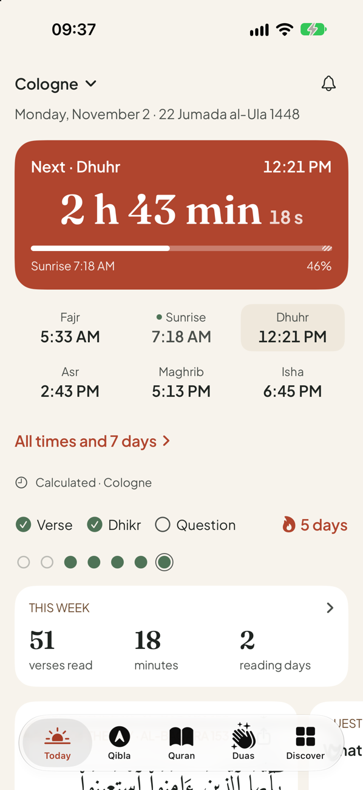
  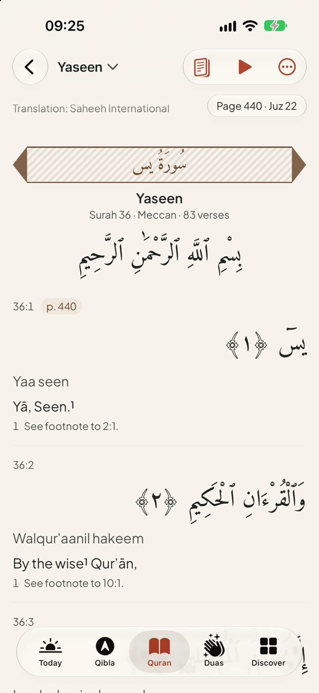
  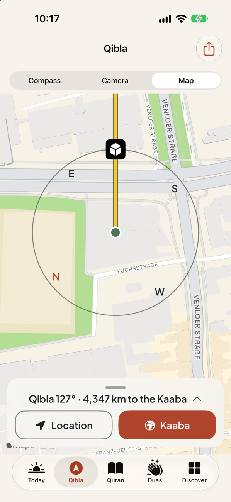
</p>

## Why Kıblegâh?

Many Muslims in Germany and Türkiye follow the prayer times of the Diyanet, but most apps either calculate with a different method or need a server for every look at the clock. Kıblegâh computes the times on the iPhone itself, following Diyanet's published method, including its rule for the short summer nights above 45° latitude. It works offline, and it has no account, no ads and no tracking.

## Download

Kıblegâh is not on the App Store yet. Until then you can build it yourself (see [Building](#building)).

## Features

- **Prayer times on the device,** compatible with Diyanet's tables (İmsak 18°, Yatsı 17°/16°, temkin, high-latitude rule), tested against Diyanet's published times for places in Türkiye, Germany and beyond.
- **Notifications that fit the day:** at the time and as a reminder before it, optionally breaking through Focus, the full adhan as an alarm through AlarmKit, and reminders before the times when prayer is disliked (kerahat).
- **Qibla** with a compass and a camera view that shows the direction over the live image.
- **Quran reader** with the Uthmani text, tajweed colours, transliteration, translations (Turkish, German, English) and the Al-Mukhtasar tafsir; a mushaf view, recitations with word-by-word highlighting, bookmarks, notes, reading goals and a memorization mode.
- **Discover:** supplications from the Quran, dhikr with a counter, the 99 names of Allah, a hadith encyclopedia, a step-by-step prayer guide and a Hijri calendar with religious days.
- **Search** across the Quran, translations and hadith, by words and by meaning.
- **A daily quiz** and a duel mode with friends.
- **Widgets, a Live Activity, a Control Center control and an Apple Watch app** with complications.
- **Optional iCloud sync** of bookmarks, notes and progress across your devices.
- **Turkish, German and English,** light and dark appearance, several colour palettes and a large-and-simple mode.

## Screenshots

### iPhone

<p align="center">
  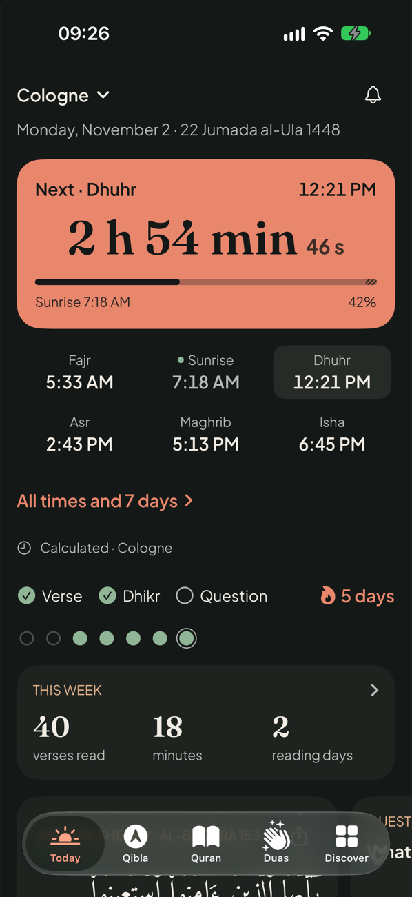
  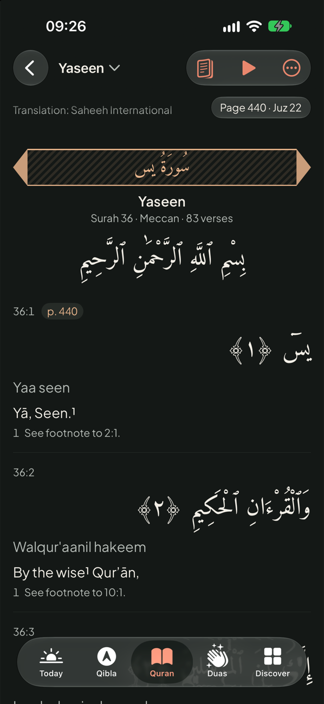
  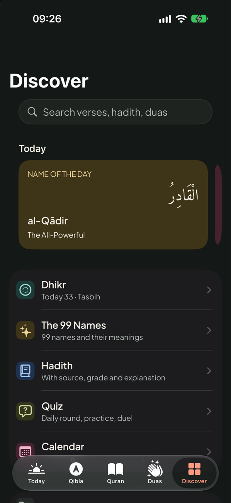
  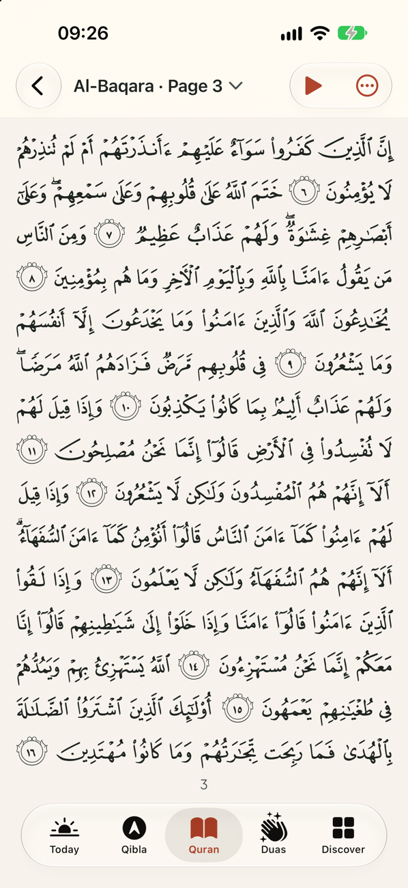
</p>
<p align="center">
  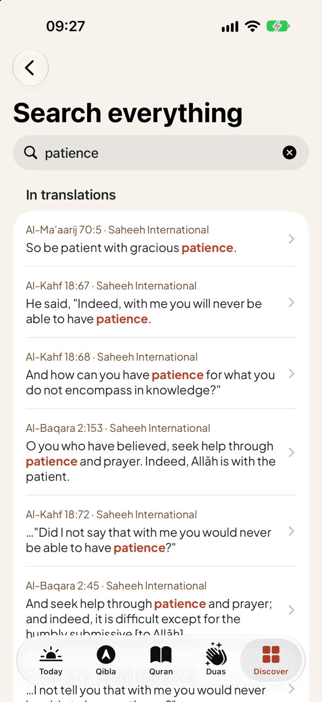
  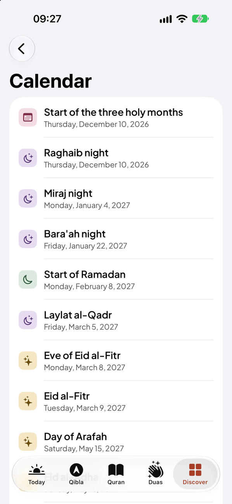
  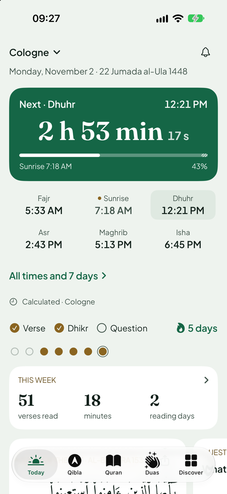
  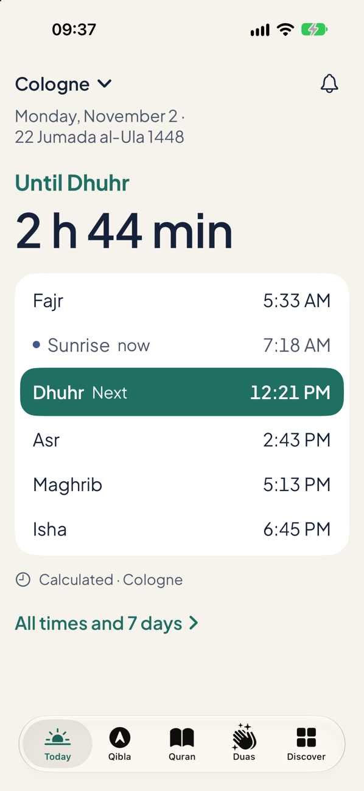
</p>

### Apple Watch

<p align="center">
  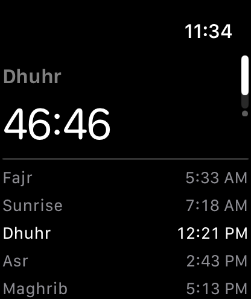
  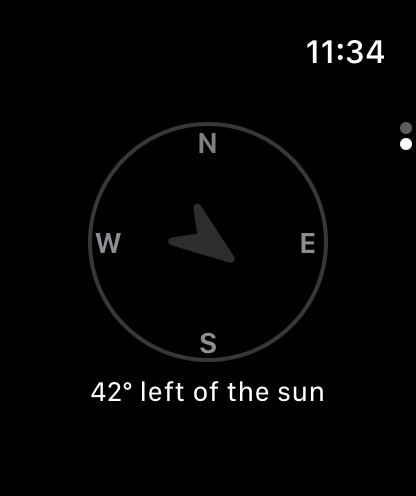
  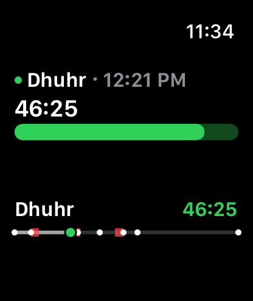
  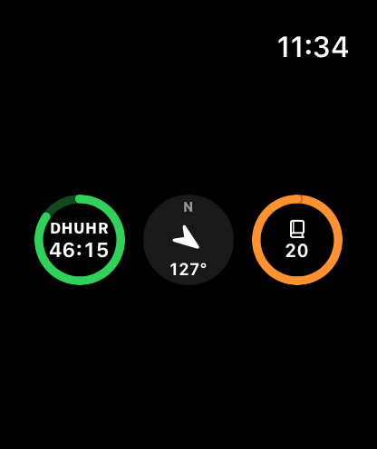
</p>

The complications are shown in full colour as the watch app renders them for these screenshots (`tools/screenshots.sh`); on a watch face they also come in the face's tint. A corner complication for the next prayer is available as well.

### Türkçe

<p align="center">
  
  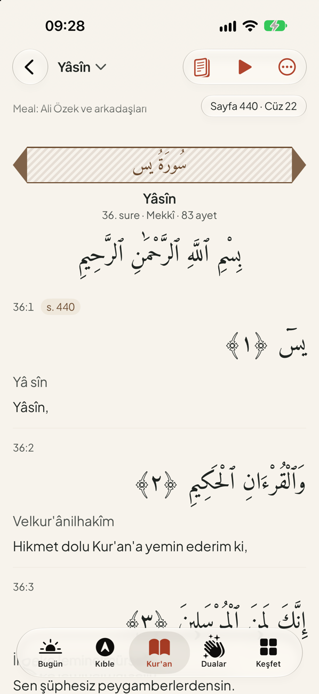
  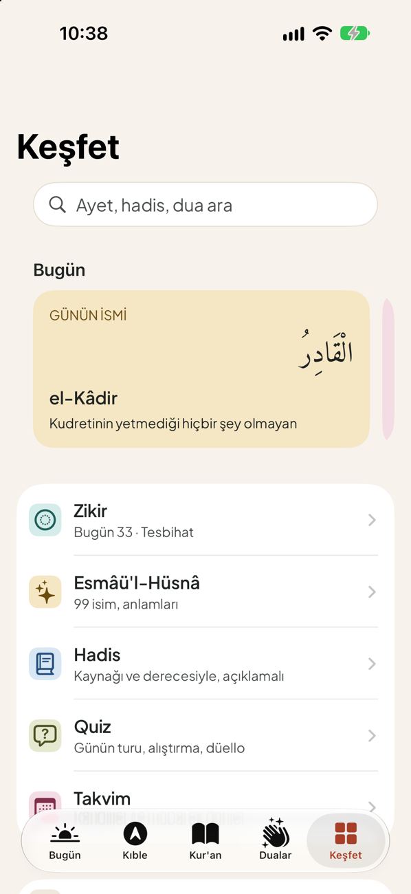
</p>

## Requirements

| | |
|---|---|
| Xcode | 27 or later |
| iOS / watchOS | 26.0 or later |
| [XcodeGen](https://github.com/yonaskolb/XcodeGen) | 2.46 or later |
| Python | 3.10 or later, `curl`, for building the content packs |

## Building

The Xcode project is generated from `project.yml` and is not checked in. The religious texts are not part of this repository; `tools/content/fetch.sh` downloads them from their original publishers and builds the content packs (see [CONTENT.md](CONTENT.md) for every source and its terms).

```sh
git clone https://github.com/ms-solutions-dev/kiblegah.git
cd kiblegah
tools/content/fetch.sh          # downloads and builds the content packs (≈ 20 min the first time)
xcodegen generate
open Kiblegah.xcodeproj
```

Choose the `Kiblegah` scheme and run it on a simulator. `fetch.sh --no-hadith` skips the large hadith download, and `--no-vector` skips the semantic search index (which needs a small Python environment that the script creates in `tools/content/.venv`). Without any content packs the app still builds and runs; prayer times and qibla work, and the Quran and Discover areas show empty states.

To run it on your own devices, copy `Config/Local.xcconfig.example` to `Config/Local.xcconfig`, enter your development team, and change the bundle identifiers (`dev.ms-solutions.kiblegah…`), the app group and the iCloud container in `project.yml`. The mushaf page layout needs your own relay with Quran Foundation API credentials (see [relay/README.md](relay/README.md)); without it the mushaf view shows the reflowed text.

Each package under `Packages/` has its own tests:

```sh
swift test --package-path Packages/PrayerTimes
```

Suites that check the real content packs run only after `tools/content/fetch.sh`.

## Project layout

| Path | Contents |
|---|---|
| `App/`, `Widget/`, `Watch/` | App, widget and watch targets |
| `Packages/Features` | Screens and navigation |
| `Packages/PrayerTimes` | Prayer time calculation, Hijri calendar, notification planning |
| `Packages/Qibla` | Qibla direction and compass |
| `Packages/Quran`, `Packages/Duas` | Recitation, word-by-word data, supplications, dhikr, prayer guide |
| `Packages/ContentPacks` | Reading the content packs, search |
| `Packages/UserData` | SwiftData models, settings, iCloud sync |
| `Packages/Core`, `DesignSystem`, `WidgetBridge` | Shared foundation, theme and fonts, widget snapshot |
| `tools/content/` | Download and build scripts for the content packs |
| `relay/` | Optional Cloudflare Worker for Quran Foundation endpoints that need credentials |

More in [ARCHITECTURE.md](ARCHITECTURE.md).

## Privacy

Your location is used on the device to compute prayer times and the qibla; it is not sent anywhere. Kıblegâh has no analytics, no tracking and no account with us. Bookmarks, notes and progress stay on your device, or in your private iCloud database if you turn on sync. When you play recitations or open word meanings, the app loads them from the Quran Foundation's servers.

## Contributing

Bug reports and pull requests are welcome, see [CONTRIBUTING.md](CONTRIBUTING.md). Before your first pull request is merged, you sign our [Contributor License Agreement](CLA.md) with a one-line comment. You keep the copyright in your work.

**Translations:** all user-facing text lives in the string catalogs (`*.xcstrings`). Adding a language is a good first contribution.

## Credits

- Quran text: [Tanzil.net](https://tanzil.net) (CC BY 3.0); tajweed data: [cpfair/quran-tajweed](https://github.com/cpfair/quran-tajweed) (CC BY 4.0)
- Translations and tafsir: [QuranEnc.com](https://quranenc.com); hadith: [HadeethEnc.com](https://hadeethenc.com); names of Allah: Wikipedia (CC BY-SA 4.0), Turkish meanings in our own wording (following Diyanet, the TDV İslâm Ansiklopedisi and others, independently reviewed)
- Recitations and word data: [Quran Foundation](https://quran.foundation)
- Semantic search: [model2vec](https://github.com/MinishLab/model2vec), potion-multilingual-128M (MIT)
- Typefaces: [Amiri](https://github.com/aliftype/amiri), [Fraunces](https://github.com/undercasetype/Fraunces), [Plus Jakarta Sans](https://github.com/tokotype/PlusJakartaSans), SIL Open Font License 1.1
- Adhan recording: Wikimedia Commons, CC0

The full list with terms is in [CONTENT.md](CONTENT.md).

## License

Copyright © 2026 ms-solutions

Kıblegâh is free software: you can redistribute it and/or modify it under the terms of the GNU General Public License as published by the Free Software Foundation, either version 3 of the License, or (at your option) any later version. See [LICENSE](LICENSE).

The religious texts downloaded by `tools/content/fetch.sh` are not covered by this license; see [CONTENT.md](CONTENT.md).
